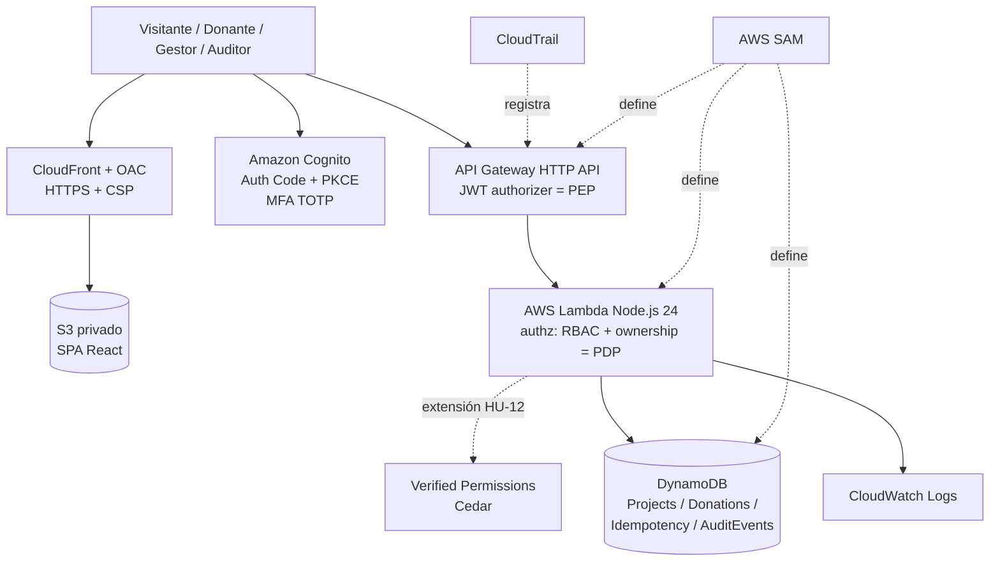

# Implementation Plan: Plataforma de Donaciones Seguras — Fundación AQP-SOLIDARIA

**Branch**: `001-plataforma-donaciones-seguras` | **Date**: 2026-11-08 | **Spec**: [spec.md](./spec.md)

**Input**: Feature specification from `/specs/001-plataforma-donaciones-seguras/spec.md`

**Fuente única de este plan**: [design.md](../../design.md), tal como está escrito, sin alternativas
propuestas ni reinterpretación del orden de trabajo de su sección 9. Cada bloque se marca explícitamente
como **[MVP]** o **[Extensión — HU-10/HU-12]** según requirements.md §5.

## Summary

El sistema es una aplicación cloud-native serverless con modelo de seguridad Zero Trust (NIST SP 800-207):
SPA React estática servida por CloudFront/S3 y una API Node.js en AWS Lambda detrás de API Gateway HTTP
API, con Amazon Cognito como identidad, DynamoDB como persistencia y AWS SAM como IaC (design.md §1–§3).
El enfoque técnico es **[MVP]** para los módulos `projects`, `donations` (intención y simulación),
`authz` (RBAC + ownership embebido) y `audit`; y **[Extensión — HU-12]** para la externalización de
autorización con Amazon Verified Permissions/Cedar, y **[Extensión — HU-10]** para el endpoint de consulta
de auditoría `GET /v1/audit`.

## Technical Context

**Language/Version**: TypeScript (fijar una versión compatible con typescript-eslint y Vitest; la última
estable es 7.0.x) — **[MVP]** (design.md §2).

**Primary Dependencies**:
- Frontend **[MVP]**: React 19.3.x + React DOM, Vite 8.3.x, Tailwind CSS 4.x (Bootstrap prohibido), Radix
  UI (opcional) + Lucide React, React Router 8.x, React Hook Form 7.x + Zod 4.x, TanStack Query 5.x,
  `oidc-client-ts` (o AWS Amplify Auth) para Authorization Code + PKCE con tokens en memoria.
- Backend **[MVP]**: Node.js 24 (`nodejs24.x` en Lambda), Amazon API Gateway HTTP API, AWS Lambda (una
  función por caso de uso o por módulo), Amazon Cognito User Pool (plan Lite o Essentials) + grupos,
  módulo `authz` embebido en Lambda.
- Backend **[Extensión — HU-12]**: Amazon Verified Permissions + Cedar como Policy Engine externo.
(design.md §2)

**Storage**: Amazon DynamoDB (on-demand) — tablas `Projects`, `Donations`, `Idempotency`, `AuditEvents` —
**[MVP]** (design.md §2, §5).

**Testing**: Vitest 5.x + Testing Library + Bruno/Postman (unitarias, UI, API negativas) — **[MVP]**
(design.md §2, §9).

**Target Platform**: AWS Free plan, una sola región (recomendado `us-east-1`); frontend en S3 privado +
CloudFront con OAC; backend en AWS Lambda detrás de API Gateway HTTP API — **[MVP]** (design.md §2, §6).

**Project Type**: aplicación web (frontend SPA + backend serverless) — **[MVP]** (design.md §1 AD-02).

**Performance Goals**: con 50 proyectos, el 95% de respuestas GET del backend (excluyendo cold start)
completa en ≤ 1.5 s desde un cliente cercano a la región — **[MVP]** (RNF-HU-05, design.md referenciado
en spec.md).

**Constraints**: backend autoritativo (permisos, importes y transiciones validados solo en servidor,
dinero en céntimos enteros de PEN); idempotencia atómica vía `TransactWriteItems` condicionado; access
token ≤ 15 min; tokens en memoria (no en almacenamiento persistente del navegador); cero datos de pago
reales; mínimo privilegio por rol IAM por función Lambda; endpoint de simulación de confirmación solo en
stage `academic` — **[MVP]** (design.md §1 AD-04/AD-05/AD-07, §4, §6.3).

**Scale/Scope**: catálogo de hasta 50 proyectos para la medición de rendimiento; 4 roles (Visitante,
Donante, Gestor, Auditor); 12 historias de usuario (HU-01 a HU-12) y 14 casos de prueba (T01–T14) —
**[MVP + Extensión]** (requirements.md §2, §6).

## Constitution Check

*GATE: Must pass before Phase 0 research. Re-check after Phase 1 design.*

| Principio constitucional | Evaluación contra design.md | Resultado |
|---|---|---|
| I. Zero Trust (NIST SP 800-207) | API Gateway HTTP API con JWT authorizer = PEP; módulo `authz` en Lambda = PE (MVP) o Amazon Verified Permissions/Cedar = PE externo (Extensión HU-12); Cognito = PA (design.md §6.1) | PASA |
| II. Backend autoritativo | AD-04: permisos, importes y transiciones validados solo en servidor; dinero en céntimos enteros | PASA |
| III. Cero datos de pago reales | AD-03: donaciones simuladas; endpoint de simulación condicionado al stage `academic` en SAM | PASA |
| IV. Idempotencia atómica | AD-05: `TransactWriteItems` condicionado para clave de idempotencia y donación | PASA |
| V. Mínimo privilegio | Un rol IAM por función Lambda con acciones/tablas mínimas (design.md §1 AD-06, §7) | PASA |
| VI. Cuenta AWS Free plan única | Una cuenta, una región, alerta en AWS Budgets, servicios verificados contra la lista del Free plan (design.md §7) | PASA |
| VII. Stack tecnológico fijo | El Technical Context anterior reproduce exactamente design.md §2 sin alternativas | PASA |

No se detectan violaciones; no se requiere la tabla de Complexity Tracking.

## Project Structure

### Documentation (this feature)

```text
specs/001-plataforma-donaciones-seguras/
├── plan.md              # This file (/speckit-plan command output)
├── research.md          # Phase 0 output (/speckit-plan command)
├── data-model.md        # Phase 1 output (/speckit-plan command)
├── quickstart.md        # Phase 1 output (/speckit-plan command)
├── contracts/           # Phase 1 output (/speckit-plan command)
└── tasks.md             # Phase 2 output (/speckit-tasks command - NOT created by /speckit-plan)
```

### Source Code (repository root)

Estructura transcrita exacta de design.md §8 («Estructura propuesta de GitHub»):

```text
secure-donations-2026/
├── frontend/                  # React + Vite + Tailwind — [MVP]
│   ├── src/pages/
│   ├── src/components/
│   ├── src/auth/              # oidc-client-ts, tokens en memoria — [MVP]
│   └── src/services/
├── backend/
│   ├── src/projects/          # [MVP]
│   ├── src/donations/         # [MVP]
│   ├── src/authz/             # RBAC + ownership embebido — [MVP]; interfaz hacia Verified Permissions — [Extensión HU-12]
│   ├── src/audit/             # generación de eventos — [MVP]; endpoint de consulta GET /v1/audit — [Extensión HU-10]
│   ├── src/shared/            # esquemas Zod, errores, logger — [MVP]
│   └── test/
├── infra/template.yaml        # AWS SAM (stage academic) — [MVP]
├── policies/                  # Cedar — [Extensión HU-12]
├── docs/api.yaml               # OpenAPI 3.1 — [MVP]
├── docs/threat-model.md        # STRIDE resumido + mapeo NIST — [MVP]
├── evidence/                   # capturas sanitizadas, reportes de pruebas — [MVP]
├── .github/workflows/ci.yml    # [MVP]
├── requirements.md
├── design.md
├── README.md
└── AI_USAGE.md
```

**Structure Decision**: se adopta exactamente la estructura de design.md §8 (aplicación web con `frontend/`
y `backend/` en un único repositorio, sin microservicios — AD-02), con `policies/` reservado para la
extensión HU-12 y el endpoint de auditoría de `src/audit/` marcado como extensión HU-10. No se introduce
ninguna carpeta ni capa adicional no mencionada en design.md.

## Arquitectura (design.md §1 y §3, transcrito)

**Decisiones arquitectónicas (AD-01 a AD-08):**

- **AD-01 — Zero Trust como modelo de seguridad [MVP]**: identidad y permisos verificados en cada
  solicitud; ninguna confianza por ubicación de red; privilegio mínimo para personas y cargas de trabajo;
  asumir brecha. ZTA no es un estilo de descomposición funcional.
- **AD-02 — Serverless modular [MVP]**: SPA React estática y API Node.js en Lambda; módulos `projects`,
  `donations`, `authz`, `audit` en un único repositorio, sin imponer microservicios.
- **AD-03 — Transacciones simuladas [MVP]**: donaciones como estados simulados; no procesar pagos
  reales. Una versión productiva requeriría un PSP con tokenización, webhooks firmados, conciliación,
  antifraude y revisión legal.
- **AD-04 — Backend autoritativo [MVP]**: permisos, importes y transiciones se validan solo en servidor;
  dinero en enteros (céntimos de PEN).
- **AD-05 — Idempotencia atómica [MVP]**: reserva de clave y creación de donación en un único
  `TransactWriteItems` condicionado.
- **AD-06 — Cuenta AWS Free plan [MVP]**: una cuenta por equipo, una sola región (recomendado
  `us-east-1`), usuarios IAM con MFA por integrante. IAM Identity Center, Organizations, Verified Access,
  GuardDuty y Security Hub no están disponibles en el Free plan y quedan fuera del diseño.
- **AD-07 — Tokens de vida corta [MVP]**: access token ≤ 15 min y refresh token revocable, porque el JWT
  authorizer no consulta revocaciones.
- **AD-08 — Autorización en dos niveles**: MVP con RBAC + ownership en el módulo `authz` **[MVP]**;
  extensión HU-12 con Amazon Verified Permissions (Cedar) como Policy Engine externo **[Extensión —
  HU-12]**.

**Diagrama lógico (design.md §3, transcrito tal cual):**



**Límites de confianza [MVP]**: navegador (no confiable) → API Gateway (verifica JWT) → Lambda (autoriza
rol, propietario y negocio) → DynamoDB (restringido por IAM por función). El frontend no contiene
secretos ni credenciales AWS.

## Componentes y contratos (design.md §4, transcrito)

### Módulos del backend

- `projects` **[MVP]**: lectura pública de PUBLICADO; gestión solo GESTOR.
- `donations` **[MVP]**: intención, simulación, historial por propietario y agregados.
- `authz` **[MVP]**: deriva `sub` y `cognito:groups` del contexto del authorizer; aplica RBAC y ownership
  contra el recurso persistido. (La sustitución de su motor de decisión por Amazon Verified Permissions es
  **[Extensión — HU-12]**.)
- `audit` **[MVP]**: eventos estructurados y correlación por `requestId`. (El endpoint de consulta
  `GET /v1/audit` es **[Extensión — HU-10]**.)

### Endpoints mínimos (transcrito exacto de design.md §4)

| Método | Ruta | Acceso (scope / grupo) | Respuestas | Bloque |
|---|---|---|---|---|
| GET | `/v1/projects` | Público | 200 | **[MVP]** |
| GET | `/v1/projects/{projectId}` | Público (solo PUBLICADO) | 200 / 404 | **[MVP]** |
| GET | `/v1/projects/{projectId}/stats` | Público | 200 / 404 | **[MVP]** |
| POST | `/v1/projects` | `api/projects.write` + GESTOR | 201 / 400 / 401 / 403 | **[MVP]** |
| PATCH | `/v1/projects/{projectId}/publish` | `api/projects.write` + GESTOR | 200 / 401 / 403 / 404 / 409 | **[MVP]** |
| POST | `/v1/donations` | `api/donations.write` + DONANTE | 201 / 400 / 401 / 403 / 404 / 409 | **[MVP]** |
| POST | `/v1/donations/{donationId}/simulate` | `api/donations.write` + DONANTE propietario; **solo stage `academic`** | 200 / 401 / 403 / 404 / 409 | **[MVP]** |
| GET | `/v1/donations/me` | `api/donations.read` + DONANTE | 200 / 401 | **[MVP]** |
| GET | `/v1/audit` | `api/audit.read` + AUDITOR | 200 / 401 / 403 | **[Extensión — HU-10]** |

- Cabecera `Authorization: Bearer <access_token>`; las rutas protegidas declaran `AuthorizationScopes` en
  SAM, de modo que un ID token es rechazado — **[MVP]**.
- `POST /v1/donations` exige `Idempotency-Key` (UUID) y body `{ projectId, amountCents }`; `donorSub` se
  toma del contexto del authorizer — **[MVP]**.
- Errores con formato uniforme `{ code, message, requestId }`, sin detalles internos. Contrato en OpenAPI
  3.1 (`docs/api.yaml`) — **[MVP]**.

### Flujo de una donación académica (design.md §4, transcrito, **[MVP]**)

1. El usuario inicia sesión en Cognito (Authorization Code + PKCE); la SPA guarda los tokens en memoria.
2. La SPA envía la intención con access token, `amountCents` e `Idempotency-Key`.
3. API Gateway valida firma, emisor, expiración, `client_id` y scope; Lambda valida grupo, proyecto
   PUBLICADO, monto y clave.
4. Un `TransactWriteItems` crea el `IdempotencyRecord` (condición `attribute_not_exists`) y la donación
   `PENDIENTE_SIMULACION`.
5. El donante ejecuta la simulación desde una UI rotulada como prueba.
6. Un `TransactWriteItems` actualiza la donación (condición `status = PENDIENTE_SIMULACION` y
   `donorSub = :sub`) e incrementa `confirmedAmountCents` del proyecto si se confirma.
7. La UI muestra el resultado; se registran log JSON y `AuditEvent` sin datos sensibles.

## Modelo de datos y consistencia (design.md §5, transcrito, **[MVP]**)

- `Projects`: PK `projectId`; GSI `status-createdAt` para el catálogo.
- `Donations`: PK `donationId`; GSI `donorSub-createdAt` para `GET /me`.
- `Idempotency`: PK `donorSub#createDonation#idempotencyKey`; atributos `payloadHash` (SHA-256 del body
  normalizado), `donationId`, `responseStatus`; TTL `expiresAt` (24 h).
- `AuditEvents`: PK `eventType`, SK `timestamp#eventId` para filtrar por tipo y fecha — tabla en **[MVP]**;
  el endpoint que la consulta (`GET /v1/audit`) es **[Extensión — HU-10]**.

**Reglas [MVP]**: repetir clave con mismo `payloadHash` devuelve la respuesta almacenada; con hash
distinto, 409. Si la transacción falla por condición (`TransactionCanceledException`), se responde 409
sin efectos parciales. Nunca representar dinero con `float`. Las lecturas que siguen a una escritura
propia usan `ConsistentRead` cuando la consulta es por clave primaria.

## Orden de trabajo (design.md §9, transcrito tal cual, sin reinterpretar)

**Roles sugeridos** (design.md §9): (1) líder técnico y DevOps (SAM, CI, cuenta); (2) identidad y
seguridad (Cognito, MFA, authz, threat model); (3) backend (donaciones, idempotencia, DynamoDB); (4)
frontend (React, accesibilidad, OIDC); (5) QA y documentación (pruebas T01–T14, evidencias, informe). Con
4 integrantes, QA y documentación se reparte entre todos.

| Día | Objetivo | Entregable verificable | Bloque |
|---|---|---|---|
| 1 | Análisis, threat model, cuenta Free plan, repositorio y CI | Cuenta segura, `main` protegida, CI en verde con proyecto vacío | **[MVP]** |
| 2 | Infraestructura base y autenticación | SAM con Cognito, API y DynamoDB desplegados; login PKCE funcionando; T02 y T11 | **[MVP]** |
| 3 | Proyectos y catálogo | HU-01, HU-02, HU-08, HU-09; T01, T03 | **[MVP]** |
| 4 | Donaciones e idempotencia | HU-05, HU-07; T04–T07, T09, T12 | **[MVP]** |
| 5 | Simulación, concurrencia y MFA | HU-06, HU-11; T08, T13, T14; CloudFront + CSP | **[MVP]** |
| 6 | Endurecimiento y extensiones | Revisión IAM (T10), logs, accesibilidad, rendimiento; HU-10/HU-12 opcional | **[MVP] (revisión IAM T10, logs, accesibilidad, rendimiento) + [Extensión — HU-10/HU-12] (opcional)** |
| 7 | Cierre | README, informe, mapeo NIST, `AI_USAGE.md`, demo y limpieza planificada | **[MVP]** |

**Esfuerzo estimado [MVP]**: 8–12 horas por integrante en la semana. Hito de control sugerido al final del
día 3 (demo de login y catálogo).

**Pruebas [MVP]**: unitarias de reglas de negocio (Vitest), componentes UI (Testing Library), integración
de endpoints contra el stage desplegado (Bruno/Postman, colección versionada) y pruebas negativas de
seguridad. Debe demostrarse que la UI por sí sola no implementa autorización (llamadas directas al API con
tokens de otros roles).

El orden de los días 1 a 7 se conserva exactamente como en design.md §9: no se reordena, divide ni fusiona
ningún día, y las extensiones HU-10/HU-12 permanecen donde el documento las ubica (día 6, "opcional"), sin
adelantarlas a días anteriores.

## Complexity Tracking

> No aplica: el Constitution Check no registró violaciones.
